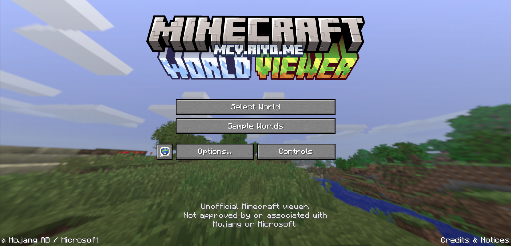
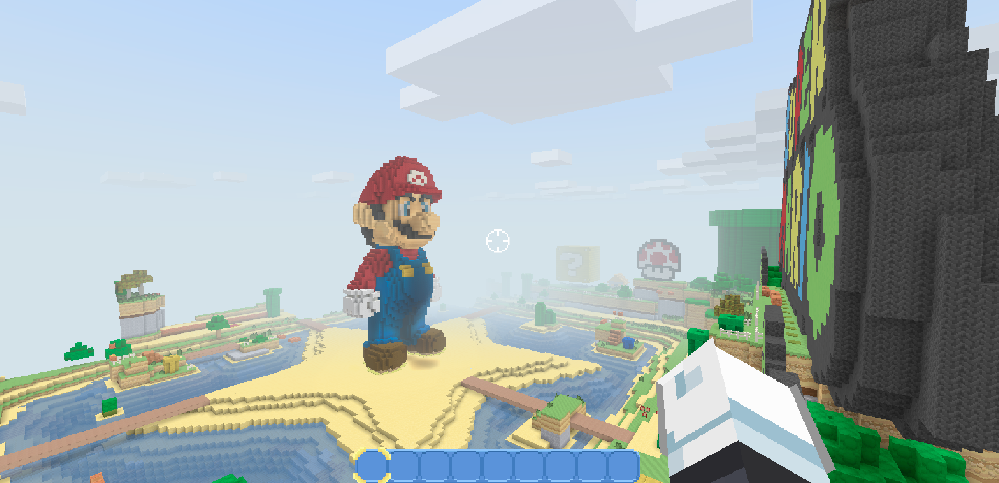
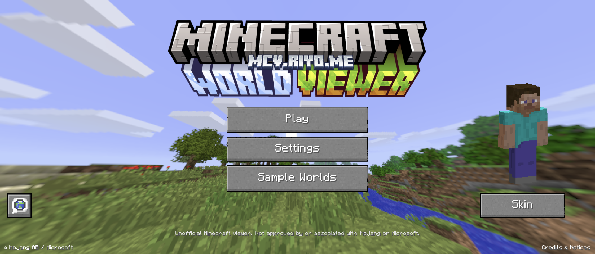
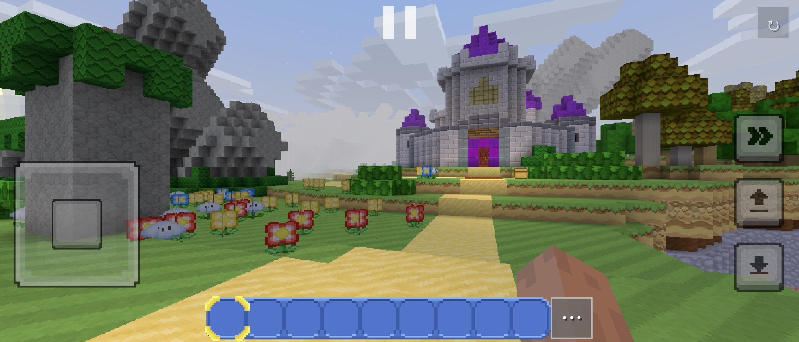
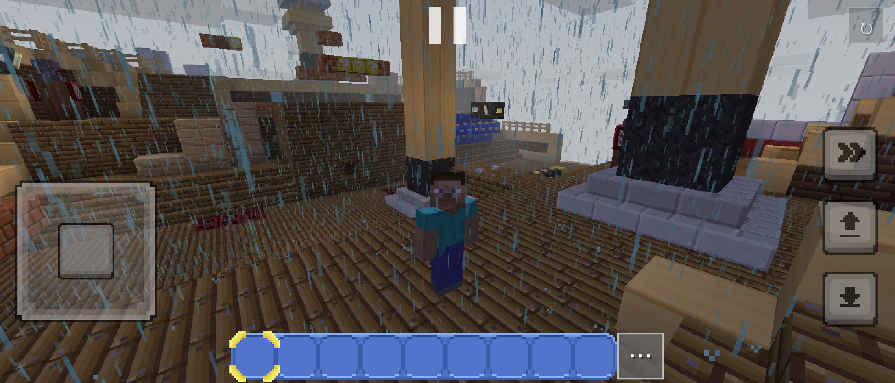
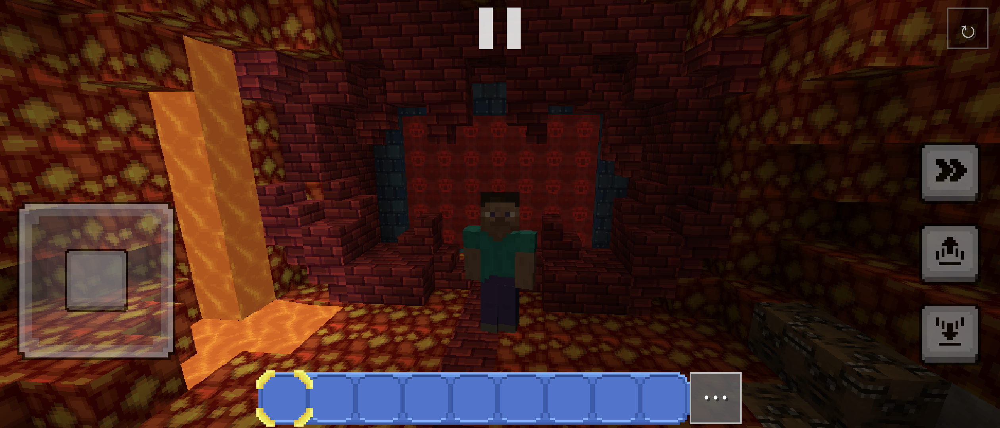

# Minecraft World Viewer

A browser-based Minecraft world viewer built with Three.js, TypeScript and Vite.

[Open the viewer](https://mcv.riyo.me/)

- Explore 14 sample tutorial and Mash-up worlds, or import a Java Edition world ZIP/folder.
- Load a resource pack alongside an imported world.
- Walk, sprint, jump, fly, switch perspective, and place or break blocks in creative mode.
- Phone/tablet touch controls with joystick, D-pad and crosshair modes.
- Adjust time, weather, view distance, and Legacy Console display gamma.
- English, Japanese, Simplified Chinese, Traditional Chinese and Korean menus.

## Screenshots

### Desktop

| Home screen | Exploring the Super Mario sample world |
| --- | --- |
|  |  |

### Mobile

| Home screen | Touch controls |
| --- | --- |
|  |  |

| Weather and third-person view | Lava-lit interiors |
| --- | --- |
|  |  |

## Playing

Imported worlds, resource packs and world edits stay in the browser's IndexedDB. They are not uploaded to the server. Reset World removes local edits to the selected world.

On a phone or tablet, open a world to show the touch controls automatically.
Swipe to look, use the left control to move, and double-tap Jump to start flying.
Double-tap Descend to stop flying. Tap a block to use/place, or hold to break.
Crosshair mode uses separate Attack and Use buttons. The `...` button beside
the hotbar opens the creative inventory; tap a slot, then an item to assign it.
Touch sensitivity, mode, size, opacity, joystick lock and auto jump are under
**Options → Controls → Touch**. See [touch controls](docs/touch-controls.md).

## Development

Use Node.js 22.12 or newer.

```sh
npm ci
npm run dev
```

The published sample worlds and game assets are loaded directly from Cloudflare R2. No asset download, conversion or environment file is required to start development. The small menu/font/import-data bundle in `public/menu/` is still required at runtime and is included in the repository.

## Checks and builds

```sh
npm test
npm run build
npm run preview
```

The default tests run without the original asset files or CDN access. They cover source types, movement/collision, skies/clouds, gamma, localization and hosting safeguards. The complete asset integration checks remain available as `npm run test:assets`; they require the separately maintained source and generated asset workspaces. See [asset maintenance](docs/assets.md).

Both local and Vercel builds contain only the app and small runtime menu bundle. They never bundle the multi-GB sample worlds.

```sh
npm run assets:verify
npm run build:vercel
```

Vercel builds also verify the published CDN release against pinned SHA-256 hashes, including every sample world's spawn data. See [hosting](docs/hosting.md).

## Configuration

The default immutable CDN release is recorded in [deployment/asset-release.json](deployment/asset-release.json). Optional overrides are documented in [.env.example](.env.example). Blank overrides use the recorded release.

Changing source code does not change the asset version. Asset generation inputs (`asset-sources/`) and outputs (`public/generated/`) are local, ignored workspaces, not repository content.

## Project structure

| Directory | Purpose |
| --- | --- |
| `src/core` | Rendering, controls, movement and audio |
| `src/minecraft` | Meshing, collision data and creative edits |
| `src/viewer` | World and resource-pack imports |
| `src/world` | Sky, weather, clouds and particles |
| `src/ui` | Native-style menus, HUD and languages |
| `public/menu` | Runtime menu resources and import reference data |
| `scripts` | CDN verification and optional asset tooling |
| `tests` | Source-only and asset integration checks |
| `deployment` | Public release metadata, pinned hashes and CORS example |

[Rendering references](docs/rendering.md) document the Console gamma curve and implementation limits.

## Credits

Unofficial project. Not approved by or associated with Mojang or Microsoft, Nintendo, or 4J Studios. Minecraft and the bundled game resources belong to their respective rights holders. Game assets are not covered by the software dependencies' licenses.

[Credits and notices](public/menu/credits.html) · [Menu asset sources](public/menu/SOURCE.md) · [Third-party license notices](public/menu/third-party-notices.txt)
